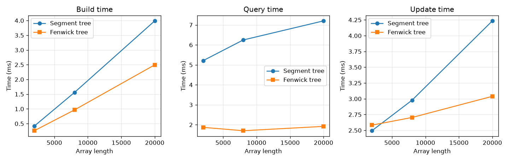
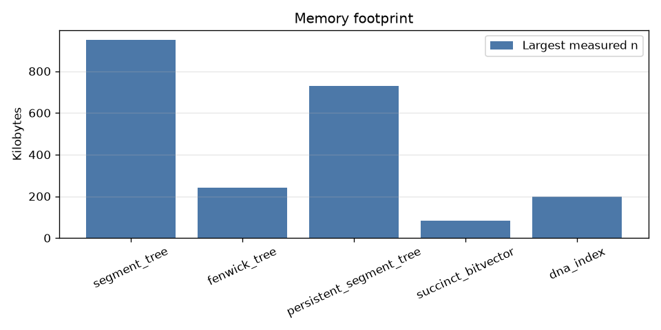
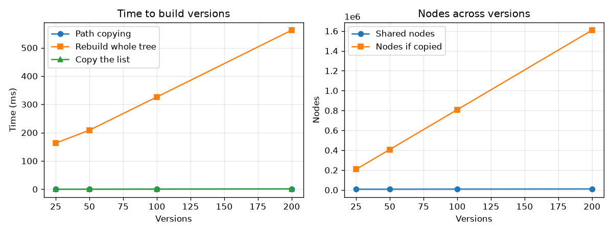
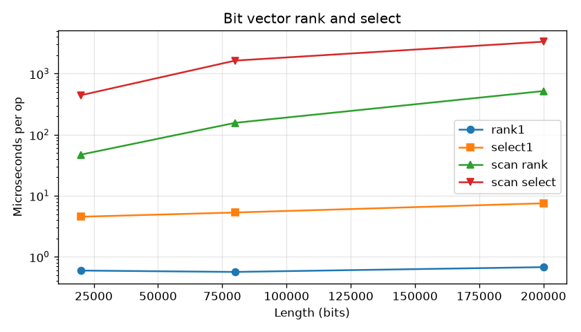
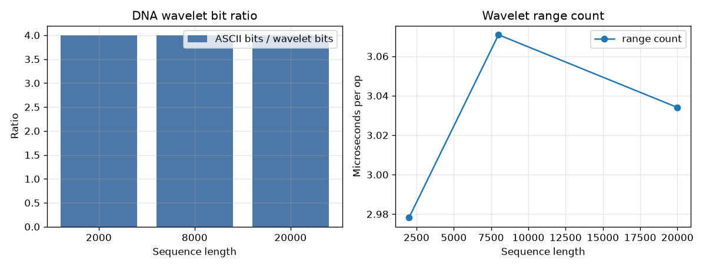
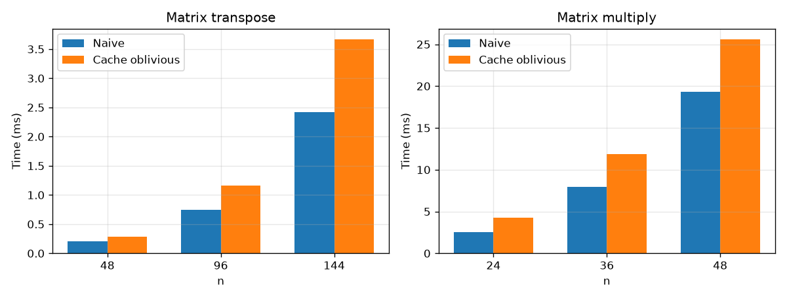
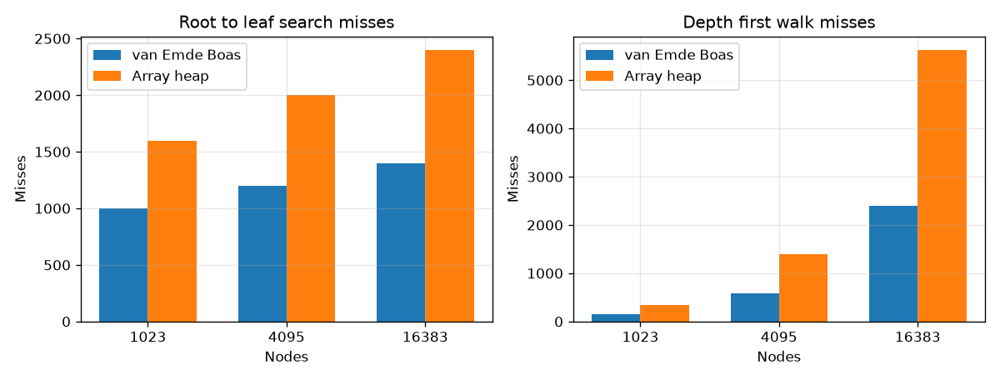

# Executive summary

I built a Python library for Chapter 12 of Amakobe, Advanced Computational Algorithms (2nd ed., 2026), and timed it on my own PC. A Fenwick tree beat a segment tree on range sums and used less memory. A persistent segment tree kept two hundred versions of a four thousand element array in 10,593 nodes, not the 1,607,799 nodes of a private tree per version. Rank on a bit vector, with superblocks, blocks, and a 16 bit table, stayed near half a microsecond. On deoxyribonucleic acid (DNA) the wavelet bit vectors hold two bits per base, while a plain string count still answered faster. The van Emde Boas layout cut simulated cache misses. Recursive matrix code did not win on the clock in this interpreter.

# Overview of advanced data structures

Amakobe starts from jobs arrays and hash tables do badly: a changing range aggregate, an old version, a long bit string, and a walk that misses the cache. Chapter 12 pairs those with a segment tree, a Fenwick tree (also a binary indexed tree), path copying, a succinct bit vector, a wavelet tree, and cache oblivious divide and conquer. I kept those shapes. The segment tree is a flat array of about 4n slots, the Fenwick tree steps by lowbit (`i & -i`), persistent nodes are never rewritten, and the bit vector is the two level directory in section 12.5.2 plus a lookup table. I did not use another textbook.

# Tree-based range queries

A leaf holds one array slot and an internal node holds the aggregate of its interval. A query is O(log n) disjoint nodes, so sum, min, and max share the walk. Build is linear, and a point update fixes one leaf and its ancestors. Lazy propagation, section 12.2.5, tags a whole segment add and pushes the tag only when a later call opens the node. A sum tag is scaled by the length. A min or max tag is added once.

The Fenwick tree only sums. Slot i covers lowbit(i) entries ending at i, and a range is the difference of two prefixes, as in section 12.3.3. At length 20,000, 1,500 queries took 7.20 ms in the segment tree and 1.92 ms in the Fenwick tree, a factor of 3.75. Queries at 2,000 and 8,000 sat in that same band, about 5.2 to 7.2 ms against about 1.7 to 1.9 ms. Builds at 20,000 were 3.99 ms and 2.50 ms. Updates stayed close, and at 2,000 elements the segment tree was actually a hair faster, 2.49 ms against 2.58 ms. At 20,000 the Fenwick update was 3.04 ms against 4.23 ms. A Fenwick write reads the old value first, so the query is where the shorter walk shows up. Retained sizes were 973,245 and 248,203 bytes.

# Persistent structures

Section 12.4 copies the root to leaf path and shares the other child pointers. After a left side edit, the new root's right child is the same object as the old one, and the old root still returns the old sum. Two hundred updates on 4,000 elements left 10,593 nodes, against 1,607,799 if every version had been private, about 152 times more. The shared history occupied 747,817 bytes. Unique nodes only grew from 8,324 at 25 versions to 10,593 at 200.

Copying a Python list after each of those 200 edits took 0.81 ms. Path copying took 1.01 ms. Across the series, path copying ran from 0.16 ms to 1.01 ms, and rebuilding a whole segment tree every edit ran from 162.94 ms to 562.12 ms. Path copying wins against that rebuild, not against the list copy. An old version is still an O(log n) walk from its root.

# Succinct and compressed structures

Section 12.5.2 wants constant time rank. Bits sit in 64 bit words. A superblock about (log n) squared bits wide stores the ones before it, a 16 bit block stores the count inside that superblock, and lookup tables finish the offset. rank1 is a few reads. select1 binary searches the superblocks and ends in the table, which is the chapter's binary search with an O(1) ending, so I call select O(log n).

On 200,000 bits, rank averaged 0.54 microseconds against 448.64 for a list scan, about 826 times, and select1 averaged 4.98 against 3,111.49. Shorter vectors stayed in the same shape: rank near 0.49 to 0.54 microseconds, scans from 39.04 up, select1 from 3.49 to 4.98. The object was 84,863 bytes, with 55,264 in the directories, because each block rank is a full 32 bit integer.

A wavelet tree (section 12.5.3) stores each alphabet split in a bit vector, so access, rank, select, a range count, and the k th symbol in a window are O(log sigma). DNA is A, C, G, T, two bits per base, ratio 4.00 against 8 bit characters: 40,000 stored bits on 20,000 bases. The clock did not follow that ratio. A string count is a C loop, and it beat the tree at every length: 1.11 microseconds against 2.85 at 2,000 bases, and 3.86 against 4.31 at 20,000. The gap narrows, and the tree never passes. The index object was 203,841 bytes.

# Cache-oblivious methods

Section 12.6 recurses until a block is small enough to fit whatever cache is there. On the clock the plain loops won. A 144 by 144 transpose was 2.42 ms against 3.67 ms, and a 48 by 48 product was 19.32 ms against 25.60 ms.

The miss model goes the other way. With least recently used replacement, 8 elements per line and 16 lines, a 64 by 64 transpose missed 4,608 times in plain order and 1,024 recursively. A 24 by 24 product with 8 lines missed 15,624 times in the triple loop and 6,528 in the recursion.

The van Emde Boas layout stores the top half of the levels, then each bottom subtree, while an array heap stores node i at index i. Two hundred root to leaf walks, with 4 lines of 8 elements, missed 1,000, 1,200, and 1,400 times in van Emde Boas order on 1,023, 4,095, and 16,383 nodes, against 1,600, 2,000, and 2,400 in the heap. Depth first walks missed 145, 578, and 2,391 times against 347, 1,403, and 5,627. Both orders visit the same ids.

# Applications (version control, DNA, range queries)

The front end in section 12.7.3 sends sums to the Fenwick tree, min or max to the segment tree, and a range add to the lazy tree. A time travel flag keeps a persistent segment tree so a query can name an older version.

Each file in the small version store is a persistent segment tree of character codes, one snapshot per commit. Equal length text is path copied, so an untouched file shares its root and the diff stops on that object. A new length is a replacement. The indented parent links are the history sketch from section 12.4.3, not a production tool.

The DNA index in section 12.5.4 counts a base with a range count and picks the k th smallest nucleotide with the quantile, ordered A, C, G, then T. Pattern frequency selects the first base and checks the rest with access, overlaps included. Tests compare those answers with direct counts on random strings.

# Benchmarks and analysis

## Methodology

I ran this on my PC: an AMD Ryzen AI 7 445 with 12 logical cores and 15 GB of memory, Windows 11, Python 3.14.7. NumPy held the matrices and Matplotlib drew the plots. Seed 5300 fixes the inputs, so the same script on another machine changes the clock and not the shape of the experiment. I timed each batch and divided by the count, and memory charges each live object once so shared nodes are not billed twice. Miss counts come from that small cache, not from hardware. Lengths stay modest. Plots and comma separated value (CSV) tables from this run are in `results/`.

## Results

The charts are this same run. At length 20,000 the Fenwick query was 3.75 times the segment query and about a quarter of the bytes, while updates stayed close. Path copying 200 versions took 1.01 ms against 562.12 ms to rebuild each tree. The string count stayed ahead of the wavelet tree. Recursive transpose misses were 1,024 against 4,608, and the van Emde Boas search on 16,383 nodes missed 1,400 times where the heap missed 2,400.

# Discussion

Amakobe counts traffic and nodes. In CPython a call and an object header often dominate, so the Fenwick query wins by a modest factor even though both are O(log n), and the updates barely separate. A list copy beats path copying on the clock and loses on nodes. A string count beats the wavelet tree at every length I measured, because that count is a C loop, while the bit ratio of 4 is still real. The recursive product cuts misses from 15,624 to 6,528 and still takes 25.60 ms against 19.32 ms. That measures the interpreter, not a failure of section 12.6. My block ranks are full 32 bit integers, which is why the directory outweighs the bits.

# Conclusion

The library does the chapter's jobs: range sum, min, and max with a lazy range add, old versions without a full clone, bit and DNA window counts, and a heap order that misses less. I would use the Fenwick tree for sums and the segment tree for min, max, or a range add. The node counts are the case for persistence. The wavelet tree stores DNA in a quarter of the character bits, and on this PC the string count still wins the clock. Cache oblivious recursion earned the misses and, here, not the milliseconds.

# Final remarks

Tests check each structure against a direct loop on random inputs, including the sum from index 1 through 4 on 1, 3, 5, 7, 9, 11. The scripts under `examples/` make those calls without the assertions. Where Python misses the chapter's space bound, the tables show the bytes I measured on this machine.
